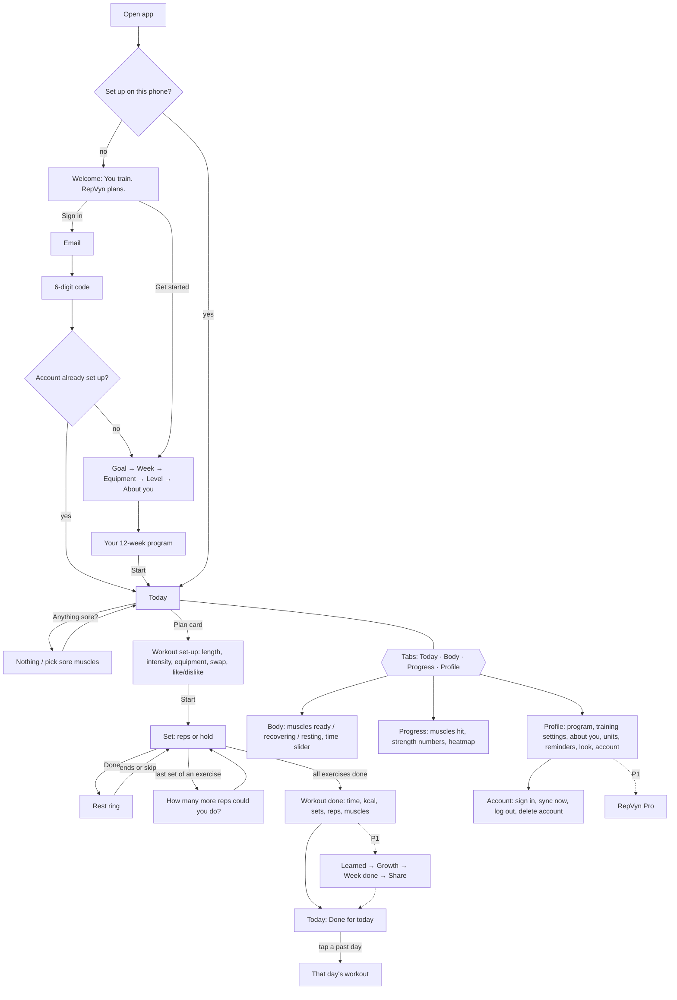

# RepVyn phone app: launch plan and user flow

Checked 21 Oct 2026. The phone app in `mobile/` is now the only app. The web app is gone. The logic both apps used (planning, the log, the workout run, sync rules, Free and Pro) now lives in `shared/`.

## 1. Where it stands

| Area | State | Notes |
|---|---|---|
| First-run set-up (goal, week, equipment, level, about you, program) | ✅ Done | `screens/onboard.tsx` |
| Today: week strip, soreness question, plan card, "done for today" | ✅ Done | `screens/today.tsx` |
| Workout set-up: length, intensity, equipment, swap, like/dislike | ✅ Done | `screens/pages.tsx` Setup |
| Workout run: set, rest ring, reps-left question; survives lock or kill | ✅ Done | `screens/workout.tsx`, `app.tsx` (kept in AsyncStorage) |
| "Workout done" screen (time, kcal, sets, reps, muscles) | ✅ Done | `Finished` in `workout.tsx` |
| Past day page, soreness page | ✅ Done | `pages.tsx` DoneDay, Sore |
| Body, Progress, Profile tabs; all settings | ✅ Done | `screens/tabs.tsx` |
| Sign in with email code, sync, log out, delete account | ✅ Done | `cloud.ts`, `screens/account.tsx` |
| Daily reminders (local notifications) | ✅ Done | `reminders.ts` |
| Android Back, predictive back, haptics, dark mode, tablets | ✅ Done | `app.tsx`, `motion.tsx` |
| Recap screens after a workout (what RepVyn learned, growth since day 1, week done, share card) | ❌ Missing | Logic exists in `shared/finish.ts`; screens not built |
| Pro: paywall, subscribe, manage, Free limits | ❌ Missing | Everything is open (same as "billing not live") |
| Privacy policy and terms links in the app | ❌ Missing | Pages are in `legal/`, still with `[BRACKETED]` gaps, and not hosted anywhere |
| Crash reports and usage numbers | ❌ Missing | Nothing reports from the phone |
| Exercise videos | ❌ Placeholder | No video content exists |
| Release build for Google Play (signed AAB, version code) | ❌ Missing | Only debug-signed APKs built so far |
| iPhone | ❌ Not started | Android first |

Checks run: phone app typecheck passes; engine and shared-logic tests pass (see the test note at the end).

## 2. Plan

### P0: needed before anyone outside can use it
1. **Email sender (SMTP).** Supabase's built-in sender only sends a few emails an hour, so most people would never get their sign-in code. Add Resend or Postmark in Supabase → Auth → SMTP (`docs/LAUNCH-SETUP.md` step 2.5). *Yours: needs an account and a domain.*
2. **Decide how Pro is sold** (see section 4). Until then ship with everything free, which is what the app does today.
3. **Privacy policy online.** Google Play needs a public privacy policy link and an account-deletion link. Fill the `[BRACKETED]` items in `legal/privacy.html` and `legal/terms.html`, host them (GitHub Pages or any static host), then add "Privacy" and "Terms" rows to Profile that open them.
4. **Release build.** Add `android.versionCode` to `mobile/app.json`, create an upload key, build a signed AAB (`gradlew bundleRelease`) instead of an APK, and fill Play Console's data-safety form (email, training log, notifications; no ads, no tracking).
5. **One full test pass on the phone** using the checklist in section 5.

### P1: what makes it feel finished
6. **Recap screens.** After "Workout done": what RepVyn learned (next-time numbers), growth since day 1, the "week on plan" moment, and a share card. This is the payoff the product promises (PRODUCT.md principle 3). The numbers are already worked out in `shared/finish.ts`. Sharing an image needs `expo-sharing` and `expo-file-system`; the card can be captured with Skia (`makeImageFromView`), which is already installed.
7. **Crash reports.** Add Sentry (`@sentry/react-native`) so a crash on someone's phone reaches you.
8. **Pro**, as decided in section 4: Pro page, subscribe, restore, manage, and the Free limits (no dumbbells or bench, 28 days of history after the free week).

### P2: after launch
9. Exercise videos or animated demos, replacing the placeholder.
10. Usage numbers (PostHog: app opened, set-up done, workout finished, paywall viewed).
11. iPhone build (needs an Apple developer account and a Mac or EAS Build).
12. Backend clean-up: the `send-reminders` function and its 5-minute cron only sent web push, which nothing uses now. Turn off the cron job, then remove the function and the push tables in a migration.

## 3. User flow

Side paths that must keep working:
- **Leave mid-workout** (Back, or the phone locks or the app is killed): the run is kept and the clock catches up when you return. Ending early saves the sets done.
- **No internet**: everything works; sync resumes later. Log out is refused while unsynced work is on the phone.
- **Second phone**: signing in brings down the training and settings; the account's settings win.
- **Reminder**: a notification at the chosen time on days not yet trained.

## 4. Decision needed: how to sell Pro on Android

Google Play requires its own billing for subscriptions that unlock app features. Razorpay checkout inside the app breaks that rule and gets apps removed. (India's "user choice billing" lets you offer another processor next to Play's, but Play billing still has to be there.)

| Option | Effort | Notes |
|---|---|---|
| **A. Launch free, add Pro later** (recommended) | None now | Get real users and feedback first; build Pro in P1 |
| B. Google Play Billing via RevenueCat | About 2–3 days plus store set-up | RevenueCat handles receipts and keeps the `subscriptions` table updated through a webhook; Play takes 15% |
| C. Razorpay inside the app | — | Not allowed on Google Play for this |

The current Supabase billing functions (`billing`, `razorpay-webhook`) would stay for a future web checkout or be replaced, depending on the choice.

## 5. Phone test checklist (release build, real phone)

1. Fresh install → Get started → finish set-up → program → Today shows a plan.
2. Fresh install → Sign in with an account already set up → lands on Today with its history.
3. Start a workout, finish two sets, lock the phone for 2 minutes, unlock: the rest has moved on.
4. Kill the app mid-workout, reopen: the workout is still there.
5. Finish a workout: "Workout done", then Today shows "Done for today"; the past day opens.
6. Change days, length, equipment and dumbbells in Profile: Today's plan changes.
7. Set a reminder 2 minutes ahead on a day not trained: the notification arrives. After training today, no reminder today.
8. Airplane mode: train, turn the network back on, "Synced" updates; a second phone sees the workout.
9. Log out, sign back in: the data comes back. Delete account: the phone returns to set-up and the account is gone.
10. Dark mode, the largest font size, Android Back from every screen.
